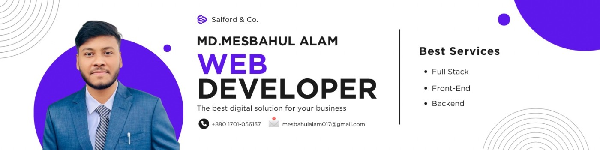

# 👋 Hi, I'm Md. Mesbahul Alam Toha

<h3 align="center">Full Stack Developer | AI & RAG Applications</h3>

  

  Building scalable web applications and practical AI-powered solutions.

  

---

## 👨‍💻 About Me

I'm a Full Stack Developer from Bangladesh focused on building practical, scalable, and user-centric software solutions.

I enjoy working across the entire development lifecycle — from designing responsive interfaces and developing secure backend systems to database architecture, third-party integrations, and deployment.

My experience includes developing business applications, logistics platforms, rental marketplaces, and AI-powered educational systems using modern web technologies.

I'm particularly interested in combining **Full Stack Engineering with Artificial Intelligence** to solve real-world problems.

- 💻 Full Stack Developer experienced in React, Next.js, Node.js, and TypeScript
- 🤖 Building AI-powered applications using LLMs and Retrieval-Augmented Generation (RAG)
- 🗄️ Experienced with MongoDB, PostgreSQL, Prisma ORM, and SQL
- 🔐 Focused on authentication, authorization, API security, and scalable backend architecture
- 🚀 Experienced in deploying and maintaining real-world web applications
- 🔬 Exploring Machine Learning, Deep Learning, and AI research
- 📍 Dhaka, Bangladesh
- 📫 **Email:** mesbahulalam017@gmail.com

---

## 🚀 Featured Projects

### 1. Shikhi Bondhu — AI-Powered Learning Platform

**AI Tutor | RAG | LLM Integration | Educational Technology**

An AI-powered educational platform designed to provide textbook-grounded learning assistance. It uses Retrieval-Augmented Generation to answer student questions based on actual textbook content, with validated page citations and appropriate responses when information is unavailable.

**Key Highlights**
- Implemented a textbook-grounded RAG pipeline with document ingestion, retrieval, and contextual answer generation.
- Supported Bengali, English, and Banglish interactions through voice and file uploads.
- Integrated four switchable LLM providers to improve flexibility and reduce vendor dependency.
- Implemented Practice and Exam modes with five auto-scored question types.
- Developed an administration console for PDF ingestion and analytics.
- Applied JWT refresh token rotation, Zod validation, and API rate limiting.

**Tech Stack:** React, TypeScript, Node.js, Express.js, MongoDB, LLM Integration, RAG, JWT, Zod

- 🌐 **Live Site:** [Shikhi Bondhu](https://departmental-ai-chatbot-dkpf.vercel.app/)
- 📦 **GitHub Repository:** [Shikhi Bondhu AI Tutor](https://github.com/mesbahtoha/Shikhi-Bondhu-AI-Tutor)

---

### 2. ZapShift — Parcel Delivery Application

**Logistics Platform | Parcel Tracking | Payment Integration**

A full-stack logistics application connecting customers, riders, and administrators through role-based dashboards, parcel management, and tracking across 64 district service centers.

**Key Highlights**
- Designed a three-role system with User, Rider, and Admin dashboards.
- Implemented parcel tracking and logistics management workflows.
- Integrated Firebase Authentication with role-based access control across 19+ admin-only API endpoints.
- Integrated Stripe Payment Intents for secure payment processing.
- Developed analytics dashboards and an interactive map using React Leaflet.
- Reduced unnecessary map re-renders by 40% through frontend optimization and TanStack Query caching.

**Tech Stack:** React 19, Vite, JavaScript, Tailwind CSS, DaisyUI, TanStack Query, Firebase Auth, React Leaflet, Node.js, Express.js, MongoDB, Stripe

- 🌐 **Live Site:** [ZapShift](https://zap-shift-client-eta.vercel.app/)
- ⚙️ **Backend API:** [ZapShift Server](https://zap-shift-server-cyan.vercel.app/)
- 📦 **GitHub Repository:** [ZapShift Parcel Delivery Application](https://github.com/mesbahtoha/Zap-Shift-Parcel-Delivery-Application)

---

### 3. GearUp — Sports & Outdoor Gear Rental Platform

**Rental Marketplace | Next.js | PostgreSQL | Prisma ORM**

A full-stack rental marketplace where customers can rent sports and outdoor equipment, providers can manage their inventory, and administrators can oversee platform operations through role-based dashboards.

**Key Highlights**
- Architected a type-safe application using Next.js 15, TypeScript, Prisma ORM, and PostgreSQL.
- Implemented JWT authentication using httpOnly cookies and Google OAuth 2.0.
- Developed separate dashboards for Customers, Providers, and Administrators.
- Integrated Stripe checkout for rental payments.
- Designed a five-stage rental lifecycle: Placed → Confirmed → Paid → Picked Up → Returned.
- Optimized data transfer, reducing overhead by 25%.

**Tech Stack:** Next.js 15, React 19, TypeScript, Tailwind CSS, TanStack Query, Zustand, Recharts, Node.js, Express.js, Prisma ORM, PostgreSQL, JWT, Google OAuth 2.0, Stripe

- 🌐 **Live Site:** [GearUp](https://gear-up-frontend-b7-a5.vercel.app)
- ⚙️ **Live API:** [GearUp Backend](https://gearup-backend-b7a4.onrender.com)
- 📦 **Client Repository:** [GearUp Frontend](https://github.com/mesbahtoha/GearUp-Frontend-B7A5)
- 📦 **Server Repository:** [GearUp Backend](https://github.com/mesbahtoha/GearUp-Backend-B7A4)

---

## 💼 Professional Experience

### Full Stack Developer — Shahi Mokam

*Contractual | 3 Months*

**Website:** [shahimokam.com](https://shahimokam.com/?module=8)

- Developed product filtering functionality to improve product discovery.
- Implemented seller onboarding with Business TIN form integration.
- Integrated Steadfast Courier API to connect marketplace orders with delivery operations.
- Added map-based location selection functionality.

### Web Developer — Fahim Pharmaceutical

*Contractual | 2 Months*

**Website:** [fahimpharmacytmss.xyz](https://www.fahimpharmacytmss.xyz/)

- Developed a Bengali-language, SEO-friendly website for a local pharmaceutical business.
- Built an online presence with a focus on accessibility and local discoverability.

### Frontend Developer — Bytespace

*Contractual | 1 Month*

**Website:** [Bytespace](https://bytespace-eta-seven.vercel.app/)

- Developed a responsive course marketplace interface.
- Implemented 18 course categories, search, filtering, and cart-to-checkout functionality.

---

## 🛠️ Technical Skills

### Programming Languages

  

### Frontend Development

  

**Libraries & Tools:** TanStack Query, Zustand, React Hook Form, shadcn/ui, Recharts

### Backend Development

  

**Technologies:** REST API Design, JWT Authentication, bcrypt.js, Zod, Firebase Authentication, Stripe SDK

### Database & ORM

  

**Technologies:** MongoDB, Mongoose, PostgreSQL, MySQL, Prisma ORM, SQL

### Artificial Intelligence & Machine Learning

  

**Technologies:** Retrieval-Augmented Generation (RAG), LLM Integration, PyTorch, NumPy, pandas, Matplotlib, Google Colab

### DevOps, Deployment & Tools

  

**Platforms & Tools:** Docker, Linux, VPS, cPanel, Git, GitHub, Postman, Figma, VS Code, Vercel, Netlify

---

## 🎓 Education & Activities

**B.Sc. in Information & Communication Engineering (ICE)**  
Daffodil International University, Dhaka  
2024 – Present

- Executive Committee Member and Program Organizer, DIU ICEC

---

## 🔬 Research Interests & Current Learning

- Machine Learning and Deep Learning
- Convolutional Neural Networks (CNN)
- Recurrent Neural Networks (RNN)
- Transformers and Attention Mechanisms
- Retrieval-Augmented Generation (RAG)
- System Design and Software Architecture
- Database Optimization and Performance Engineering

---

## 📊 GitHub Statistics

  
  

  

---

## 🌐 Connect With Me

  
  
  
  

---

## 💼 Open to Opportunities

I'm open to opportunities where I can contribute to building meaningful software products and continue growing as an engineer.

- Full Stack Developer
- MERN Stack Developer
- Next.js Developer
- AI-Powered Full Stack Developer
- Freelance & Collaborative Projects
- Open Source Contributions

  

<h3 align="center">
  ⭐ Build Meaningful Products • Solve Real Problems • Keep Learning ⭐
</h3>
